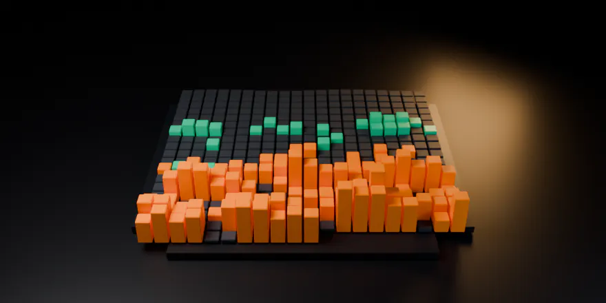

<!-- hero.svg: scripts/collect_ai_usage.py counts local Claude Code + Codex tokens,
     scripts/render_hero.py draws the scene, scripts/update.sh pushes it daily -->

<picture><source media="(prefers-color-scheme: light)" srcset="./hero-light.svg" /></picture>

<picture><source media="(prefers-color-scheme: light)" srcset="./project-light.svg" /></picture>

<picture><source media="(prefers-color-scheme: light)" srcset="./clock-light.svg" /></picture>
<picture><source media="(prefers-color-scheme: light)" srcset="./bench-light.svg" /></picture>

<!-- repos:start -->
<a href="https://github.com/ButacuEnrico/TheraViz"><picture><source media="(prefers-color-scheme: light)" srcset="./repo-1-light.svg" /></picture></a>
<a href="https://github.com/ButacuEnrico/Lares.it"><picture><source media="(prefers-color-scheme: light)" srcset="./repo-2-light.svg" /></picture></a>
<!-- repos:end -->

